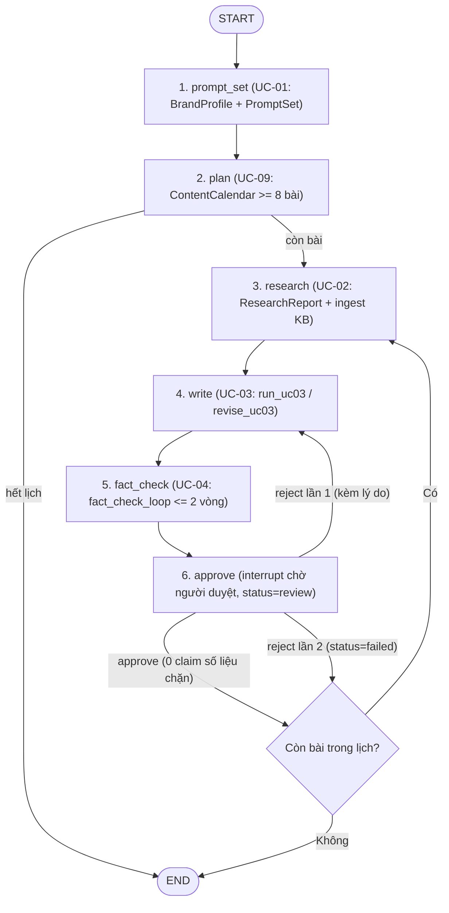

# GEO Content Writer Agent

Đồ án cuối kỳ SE373: agent viết bài blog tiếng Việt tối ưu GEO cho một thương hiệu hư cấu, có kho tri thức trích dẫn nguồn, fact-checker, editor, điểm duyệt của người và tập eval.

- Thành viên mới: đọc [docs/README.md](docs/README.md).
- Coding agent: đọc [AGENTS.md](AGENTS.md).

## Chạy hạ tầng

Cần Docker. Postgres + pgvector (service `db`) và server mini-web (service `miniweb`) chạy bằng Docker Compose.

1. Trong `.env`, đặt `POSTGRES_PASSWORD` (chỉ chữ và số) và `DATABASE_URL` theo mẫu trong `.env.example`.
2. Ở gốc repo:

   ```bash
   docker compose up -d
   ```

3. Kiểm DB: `docker compose exec db pg_isready -U postgres` in ra `accepting connections`; `pytest tests/test_db.py -v` có các test `PASSED`, không có `SKIPPED`.
4. Kiểm mini-web (sau khi Task 3 của Phase 2 merge `evals/miniweb/server.py`): mở http://localhost:8800/search?q=test, trả về JSON. Trước đó container `miniweb` tự thoát, không ảnh hưởng `db`.

Không chạy Docker thì để trống `DATABASE_URL`: test cần DB tự skip, các test khác vẫn chạy.

Máy đã có Postgres cài sẵn chiếm cổng 5432 (`docker compose up` báo `ports are not available`, hoặc báo `password authentication failed` dù mật khẩu đúng): đặt `POSTGRES_PORT=5433` trong `.env` và dùng cổng đó trong `DATABASE_URL`.

## Chạy app

Yêu cầu: Python ≥ 3.11, Node 24.

1. Cài đặt (ở gốc repo):

   ```bash
   pip install -e ".[dev]"
   cp .env.example .env   # rồi điền GEMINI_API_KEY và GEMINI_MODEL
   ```

2. Backend, chạy **từ gốc repo** (skill trong `skills/` được đọc theo đường dẫn trong repo):

   ```bash
   uvicorn app.backend.main:app --reload
   ```

3. Frontend, ở terminal khác:

   ```bash
   cd app/frontend
   npm ci
   npm run dev
   ```

   Mở http://localhost:5173, dán brief (ví dụ nội dung `data/brand/brief_sample.md`), nhập chủ đề rồi bấm **Chạy UC-01**. Vite chuyển các request `/runs` sang backend ở cổng 8000.

Chạy UC-01 không cần app:

```bash
python -m agent.uc01 --brief data/brand/brief_sample.md --topic "sơn chống nóng mái tôn"
```

## Workflow LangGraph (UC-09)

UC-09 điều phối quy trình sản xuất lịch nội dung 1 tháng (`>= 8` bài, phủ 4 tuần, 0 cannibalization, mỗi bài `>= 2` internal link) trên `StateGraph` 6 node với checkpointer (`PostgresSaver` trên Postgres, hoặc `FileCheckpointSaver` khi chạy offline) và cổng duyệt của người (`interrupt`):



Chạy UC-09 qua CLI:

```bash
python -m agent.uc09 start --brief data/brand/brief_sample.md --topic "sơn chống nóng mái tôn"
python -m agent.uc09 resume <run_id>
python -m agent.uc09 approve <run_id> --decision approve --reason "Đạt yêu cầu" --reviewer "admin"
```

## Chạy eval

```bash
python -m evals.run --all                              # chạy mọi UC có eval case, chế độ live
python -m evals.run --all --offline                    # chạy fixtures offline
python -m evals.run --all --uc uc01 uc02 --offline     # chỉ chạy UC-01 và UC-02
python -m evals.run --uc uc01 --offline                # lọc một UC
```

Mỗi module `evals/ucXX.py` cung cấp `load_cases()`, `run_case(case, live=...)` và `summarize(results)`. Report chung ở `evals/results/<timestamp>.json` có summary và kết quả theo từng UC, gồm pass rate, số lần sửa, token và thời gian trung bình mỗi case. UC chưa có module hoặc chưa có case được cảnh báo rồi bỏ qua.

Chế độ live cần `GEMINI_API_KEY`, `GEMINI_MODEL`, `GEMINI_EMBED_MODEL` và Postgres qua `DATABASE_URL`. Runner migrate schema riêng `eval` rồi nạp snapshot mini-web vào `PgKB`; embedding được lưu trong cache Postgres để các lần chạy sau tái sử dụng. UC-01 đo accuracy phân loại intent trên 40 prompt trong `evals/data/intent_labels.jsonl`; chế độ offline bỏ qua metric accuracy này vì FakeLLM không đo được chất lượng phân loại của model. Nhãn hiện là bản nháp do agent đề xuất, chưa được hai người gán độc lập rồi thống nhất chỗ lệch, nên chưa phải kết quả chính thức.
